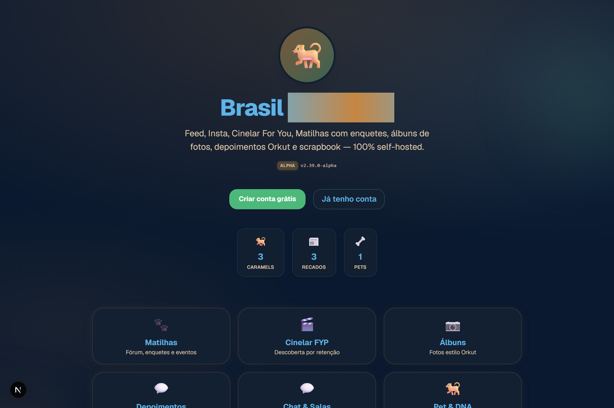
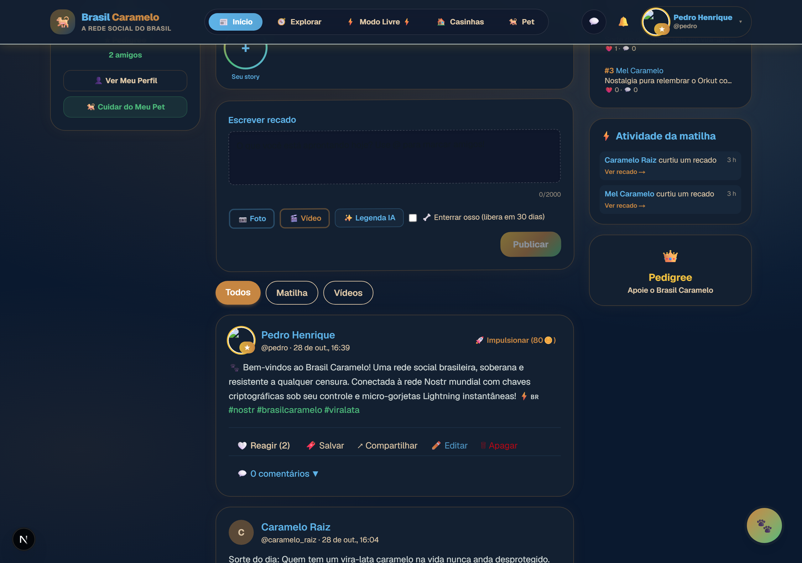
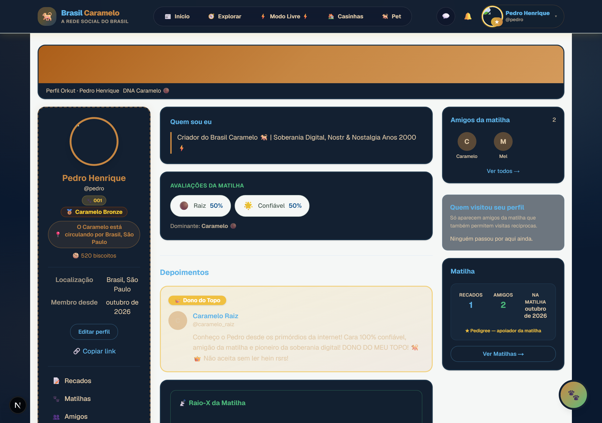
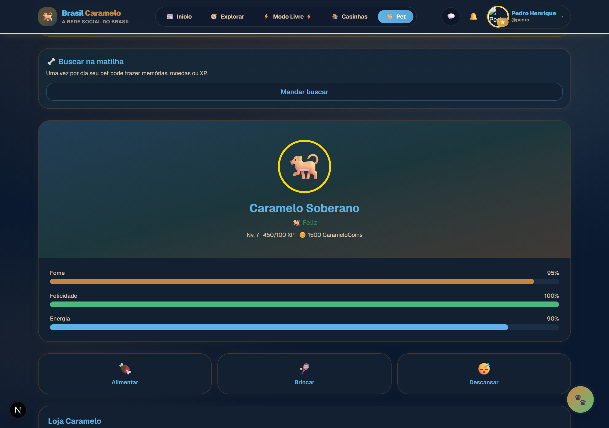
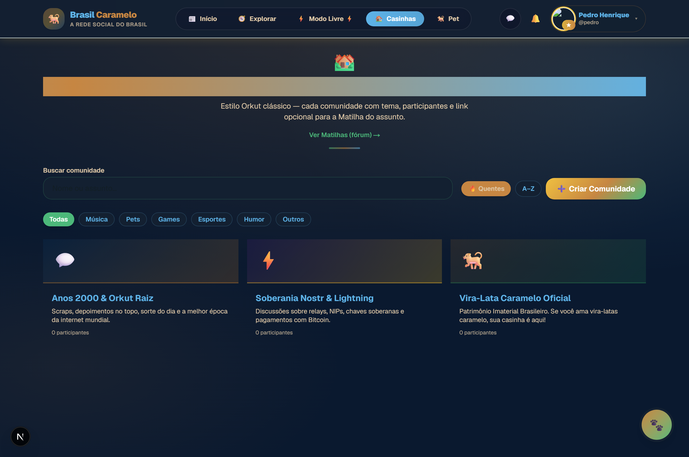
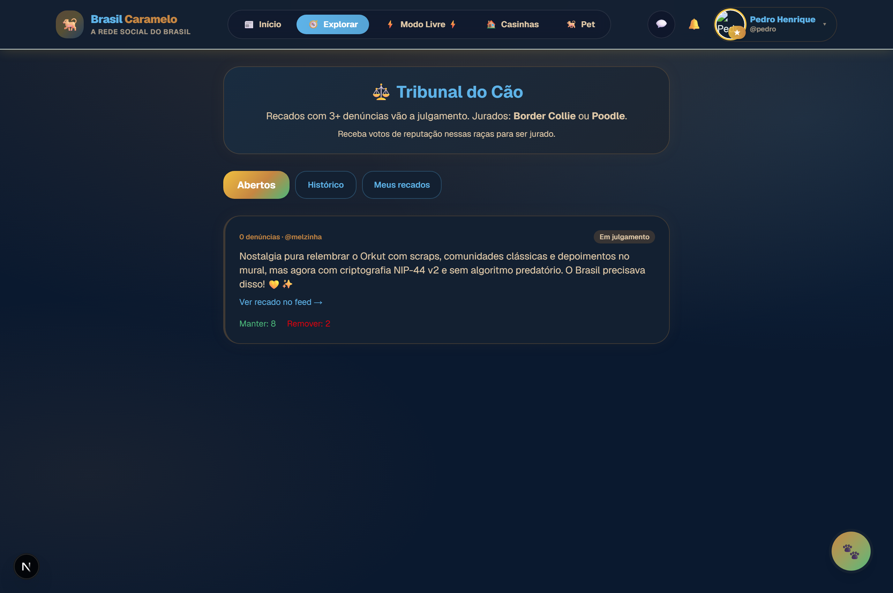
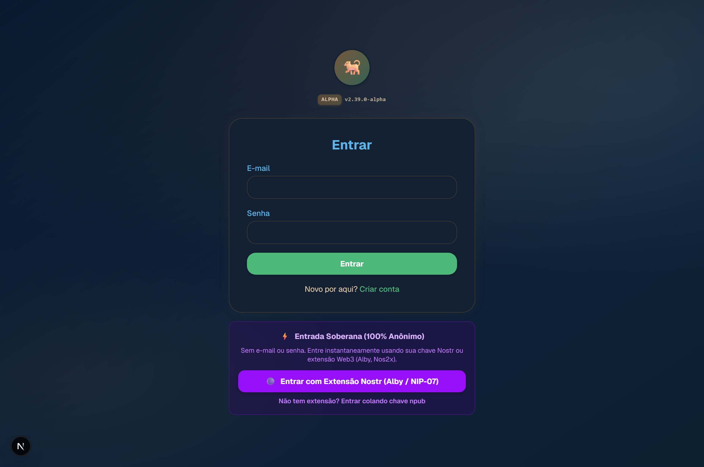
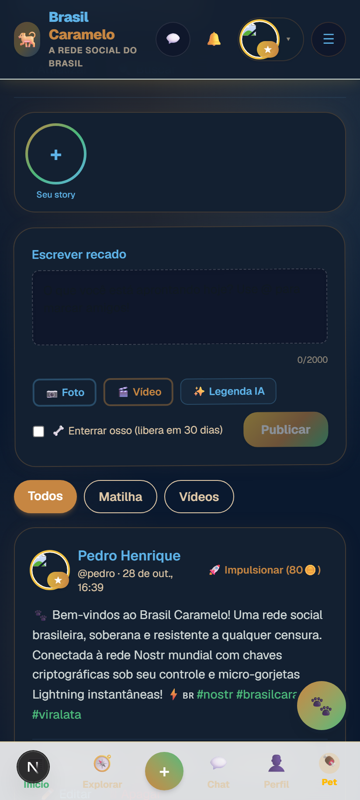
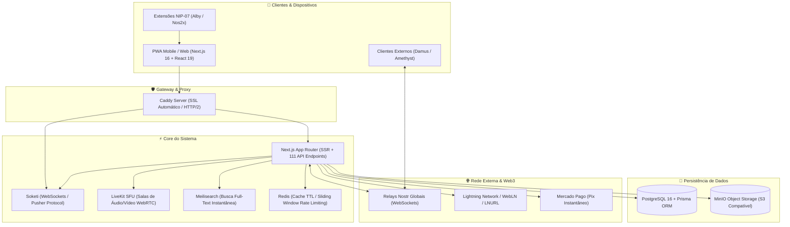

# 🐕 Brasil Caramelo (Nostr) — Rede Social Híbrida Brasileira & Soberana

<div align="center">

[](Versions.txt)
[](https://nextjs.org/)
[](https://react.dev/)
[](https://www.typescriptlang.org/)
[](https://github.com/nostr-protocol/nips)
[](https://lightning.network/)
[](docker-compose.yml)
[](public/sw.js)

**A união da nostalgia dos anos 2000 (estilo Orkut, comunidades e depoimentos) com a soberania digital, privacidade e liberdade descentralizada do protocolo Nostr (Web3) e pagamentos instantâneos via Lightning Network (Bitcoin).**

[Visão Geral](#-1-visão-geral--proposta-de-valor) • [Galeria Visual](#-demonstração-visual--telas-do-aplicativo) • [Arquitetura](#-2-arquitetura--infraestrutura) • [NIPs Nostr](#-3-nips-do-nostr-implementadas) • [Funcionalidades](#-4-funcionalidades-chave) • [Stack Tecnológica](#-5-stack-tecnológica) • [Como Rodar](#-6-como-executar-o-projeto)

</div>

---

## 🎯 1. Visão Geral & Proposta de Valor

O **Brasil Caramelo** é uma rede social brasileira **híbrida, resiliente e 100% self-hosted**, projetada para resolver problemas contemporâneos de censura, perda de soberania e monetização predatória, sem abrir mão da facilidade de uso e do carisma da internet brasileira:

* **Soberania e Liberdade de Expressão:** Publicação de recados descentralizados e incensuráveis através de relays Nostr mundiais, com chaves criptográficas sob posse exclusiva do usuário.
* **Dual-Engine Híbrido (Web2 + Web3):**
  * **Modo Tradicional (Web2):** Cadastro por e-mail/senha, banco relacional PostgreSQL de baixa latência, conformidade com LGPD (direito ao esquecimento e exportação).
  * **Modo Soberano (Nostr / Web3):** Login 100% anônimo por chaves `npub`/`nsec` ou extensões de navegador NIP-07 (Alby, Nos2x, Amber), mensagens privadas NIP-44 (ChaCha20-Poly1305) e Zaps instantâneos.
* **Gamificação & Cultura Brasileira:** Pet Virtual Caramelo dinâmico com cuidados e recompensas, economia de CarameloCoins, moderação coletiva no *Tribunal do Cão*, *Comunidades/Casinhas* e salas de áudio ao vivo (*Latidos ao Vivo*).

---

## 📸 Demonstração Visual & Telas do Aplicativo

Confira a interface do **Brasil Caramelo** unindo o design nostálgico dos anos 2000 (estilo Orkut) com a modernidade e soberania do protocolo Nostr:

| 🐕 Página Inicial & Apresentação | 💬 Feed de Recados Dual-Engine |
|:---:|:---:|
|  |  |
| *Boas-vindas nostálgicas, contadores ao vivo e apresentação* | *Recados híbridos, reações, hashtags e Zaps em satoshis* |

| 🏆 Perfil Estilo Orkut & Depoimentos | 🐾 Pet Virtual Caramelo |
|:---:|:---:|
|  |  |
| *Sorte do dia, selos, amigos da matilha e dono do topo* | *Mini-game com alimentação, cuidados e moedas* |

| 🏘️ Casinhas & Comunidades | ⚖️ Tribunal do Cão |
|:---:|:---:|
|  |  |
| *Tópicos temáticos e fóruns estilo anos 2000* | *Moderação coletiva descentralizada por jurados* |

| ⚡ Login Híbrido Web2 + Nostr | 📱 Experiência Mobile PWA |
|:---:|:---:|
|  |  |
| *Autenticação tradicional ou chave soberana NIP-07* | *Interface responsiva com navegação e mini-widget* |

---

## 🏗️ 2. Arquitetura & Infraestrutura

A aplicação adota uma arquitetura modular de microsserviços conteinerizados via **Docker Compose**:



### Serviços do Docker Compose

| Serviço | Imagem / Tecnologia | Porta | Finalidade Operacional |
|:---|:---|:---:|:---|
| **App Web** | `Next.js 16 (App Router)` | `3000` | Interface de usuário (SSR/PWA) e rotas de API Serverless |
| **Banco Relacional** | `PostgreSQL 16` | `5432` | Persistência relacional gerenciada via Prisma ORM |
| **Proxy Reverso / SSL**| `Caddy Server` | `80 / 443` | Terminação SSL/TLS automática (Let's Encrypt) e roteamento HTTP/2 |
| **Mensageria Realtime**| `Soketi (Pusher Protocol)`| `6001` | Notificações instantâneas, digitação e chats via WebSockets |
| **Áudio / Vídeo SFU** | `LiveKit Server` | `7880` | Salas de áudio ao vivo (*Latidos ao Vivo*) com chaveamento SFU |
| **Motor de Busca** | `Meilisearch` | `7700` | Busca instantânea full-text de posts, hashtags e amigos |
| **Armazenamento S3** | `MinIO Object Storage` | `9000` | Armazenamento de fotos, vídeos e áudios de depoimentos |
| **Cache & Limiter** | `Redis / In-Memory TTL`| `6379` | Cache de agregação de trending, ranking e rate limiting |

---

## 📜 3. NIPs do NOSTR Implementadas

O Brasil Caramelo implementa conformidade estrita com as especificações oficiais da rede descentralizada Nostr:

| NIP | Título | Implementação no Brasil Caramelo |
|:---|:---|:---|
| **NIP-01** | *Basic Protocol Flow* | Identidades criptográficas, assinatura Schnorr, eventos Kind 0 (perfil), Kind 1 (recados) e Kind 7 (reações). |
| **NIP-02** | *Contact Lists & Follows* | Lista de contatos e matilhas seguidas com sincronização em relays. |
| **NIP-04** | *Encrypted Direct Messages* | Criptografia legada (AES-256-CBC) para compatibilidade histórica. |
| **NIP-05** | *DNS-based Verification* | Endpoint público `/.well-known/nostr.json` para verificação de chaves `@brasilcaramelo.com`. |
| **NIP-07** | *Browser Extensions* | Autenticação e assinatura sem expor chaves privadas via `window.nostr` (Alby, Nos2x). |
| **NIP-09** | *Event Deletion Requests* | Emissão de solicitações de exclusão de notas nos relays remotos. |
| **NIP-19** | *bech32-encoded Entities* | Parsing e encoding nativo de chaves `npub1`, `nsec1`, `note1` e `nprofile1`. |
| **NIP-23** | *Long-form Content* | Publicação e leitura de artigos, crônicas e manuais formatados em Markdown. |
| **NIP-25** | *Reactions* | Reações descentralizadas (corações, biscoitos, emojis) integradas ao feed. |
| **NIP-44** | *Encrypted Payloads (Versioned)* | **Criptografia v2 de ponta a ponta** usando ChaCha20-Poly1305 + HKDF para DMs privadas. |
| **NIP-47** | *Nostr Wallet Connect (NWC)* | Conexão com carteiras Lightning externas e saque automatizado. |
| **NIP-57** | *Lightning Zaps* | Micro-gorjetas em Satoshis (Bitcoin) em posts com recibos de pagamento Kind 9735. |

---

## 🌟 4. Funcionalidades-Chave

### 🐾 Experiência Nostálgica & Comunidade
* **Perfil Estilo Orkut & Depoimentos:** Sorte do dia, recados no mural, álbuns de fotos, fãs, visualizações de perfil e selo "Confíavel / Legal / Sexy".
* **Comunidades & Casinhas:** Fóruns temáticos com tópicos fixados, moderação por donos/moderadores, enquetes e feeds restritos por comunidade.
* **Pet Virtual Caramelo:** Gamificação com alimentação, passeios, banho, níveis de felicidade/fome e recompensas diárias em CarameloCoins.
* **Tribunal do Cão:** Sistema de moderação coletiva descentralizada onde a comunidade vota em denúncias de posts ou usuários infratores.
* **Latidos ao Vivo (Salas de Áudio):** Salas de voz multi-usuário em tempo real via WebRTC SFU (LiveKit) com palco, ouvintes e reações sonoras.
* **Cinelar (Vídeos & Stories):** Stories verticais de curta duração e feed multimídia com suporte HLS e compressão inteligente.

### 🔒 Segurança & Performance
* **Cofre Criptográfico no Navegador:** Chaves `nsec` salvas com criptografia `WebCrypto AES-GCM (256-bit)` desbloqueadas apenas por senha mestra.
* **Sliding Window Rate Limiter:** Proteção contra ataques de força bruta e spam em rotas sensíveis.
* **PWA com Modo Offline:** Service Worker *Stale-While-Revalidate* permitindo leitura contínua do feed mesmo sem conexão.
* **Design System & Acessibilidade:** Tema Tri-State (Automático / Claro / Escuro OLED), paletas retrô personalizáveis, contraste WCAG e efeitos sonoros sintetizados via Web Audio API.

---

## ⚡ 5. Stack Tecnológica

| Camada | Tecnologias |
|:---|:---|
| **Frontend** | Next.js 16.2.6 (App Router), React 19.2.4, TypeScript 5, Tailwind CSS 4, Web Audio API, PWA |
| **Backend** | Next.js Server Actions & API Routes (111 rotas), Prisma ORM 7.8, Node.js |
| **Banco de Dados** | PostgreSQL 16 (índices compostos de baixa latência), Redis 7 (Cache & Rate Limiting) |
| **Multimídia & Busca** | LiveKit SFU (WebRTC), MinIO (S3 Object Storage), Meilisearch, Sharp |
| **Realtime** | Soketi (Pusher Protocol WebSockets) |
| **Web3 & Criptografia** | `nostr-tools 2.25`, ChaCha20-Poly1305 (NIP-44), WebCrypto AES-GCM, WebLN (Lightning) |
| **Monetização** | Zaps Lightning Network (Satoshis / LNbits / LND), Mercado Pago (Pix automático) |
| **Infra & DevOps** | Docker Compose, Caddy Server (Auto SSL), Capacitor (Android Ready) |

---

## 🚀 6. Como Executar o Projeto

### Pré-requisitos
* [Node.js](https://nodejs.org/) v20+ e `npm`
* [Docker](https://www.docker.com/) e `docker compose`
* PostgreSQL 16 local (ou via Docker)

---

### Opção A: Ambiente de Desenvolvimento Local

```bash
# 1. Clonar o repositório
git clone https://github.com/SEU_USUARIO/brasil_caramelo.git
cd brasil_caramelo

# 2. Instalar dependências
npm install

# 3. Configurar variáveis de ambiente
cp .env.example .env

# 4. Iniciar os serviços de apoio via Docker (PostgreSQL, Redis, Meilisearch, etc.)
docker compose up -d postgres redis meilisearch minio soketi

# 5. Executar migrações do banco de dados
npx prisma generate
npx prisma migrate dev

# 6. Rodar a suíte de testes
npm test # ou node --test tests/automated_full_suite.test.mjs

# 7. Iniciar o servidor de desenvolvimento Next.js
npm run dev
```

Acesse no navegador: **`http://localhost:3000`**

---

### Opção B: Deploy Completo com Docker (VPS / Produção)

Para subir todos os serviços orquestrados com proxy reverso e SSL:

```bash
# 1. Configurar o .env de produção
cp .env.example .env

# 2. Subir a stack completa
docker compose up -d --build
```

Ou utilize o script automatizado para VPS Ubuntu:
```bash
bash deploy-hostinger.sh
```

---

## 📁 7. Estrutura do Repositório

```text
brasil_caramelo/
├── prisma/                      # Esquema e migrações do banco relacional
│   └── schema.prisma            # Modelos de dados, enums e índices compostos
├── public/                      # Assets estáticos, ícones e Service Worker
│   └── sw.js                    # PWA Service Worker (Cache Stale-While-Revalidate)
├── relatorios/                  # Relatórios de testes e auditorias técnicas
│   ├── RELATORIO_TESTES_E2E_APLICATIVO_COMPLETO.html
│   ├── RELATORIO_TESTES_AUTOMATIZADOS_FUNCIONALIDADES.html
│   └── RELATORIO_ANALISE_GERAL_BRASIL_CARAMELO.pdf
├── src/
│   ├── app/                     # Next.js 16 App Router (36 páginas e 111 rotas de API)
│   │   ├── (app)/               # Rotas autenticadas (feed, perfil, cachorro, casinhas, tribunal)
│   │   ├── api/                 # Endpoints REST (auth, posts, pet, premium, nostr, tribunal)
│   │   └── globals.css          # Design System e variáveis de tema (Claro/Escuro OLED)
│   ├── components/              # Componentes React modulares
│   │   ├── nostr/               # Componentes Web3 (Zaps, Relays, Perfis Nostr)
│   │   ├── BottomNav.tsx        # Barra de navegação móvel com Mini-Widget do Pet
│   │   ├── StoriesOrkutBar.tsx  # Stories retrô da matilha
│   │   ├── ThemeToggle.tsx      # Alternador de tema Tri-State
│   │   └── SoundToggle.tsx      # Efeitos sonoros retrô
│   └── lib/                     # Utilitários e regras de negócio
│       ├── nostr/               # Handlers de eventos, chaves e criptografia NIP-44
│       ├── sound-fx.ts          # Síntese de áudio Web Audio API
│       ├── rate-limit.ts        # Sliding Window Rate Limiter
│       ├── cache.ts             # TTL In-Memory Cache
│       └── theme.ts             # Gerenciador de temas
├── deploy/                      # Configurações de Caddy, SSL e scripts de deploy
├── docker-compose.yml           # Orquestração de todos os 8 microsserviços
├── ROADMAP.md                   # Checklist de desenvolvimento e histórico de tarefas
└── Versions.txt                 # Changelog detalhado e histórico de versões
```

---

## 🤝 8. Contribuição & Licença

Contribuições são muito bem-vindas! Sinta-se livre para abrir uma **Issue** ou enviar um **Pull Request**.

1. Faça um Fork do projeto
2. Crie uma branch para a sua feature (`git checkout -b feature/minha-feature`)
3. Faça o commit das alterações (`git commit -m 'feat: adiciona nova funcionalidade'`)
4. Envie para o branch (`git push origin feature/minha-feature`)
5. Abra um Pull Request

Distribuído sob a licença MIT. Consulte `LICENSE` para mais informações.
